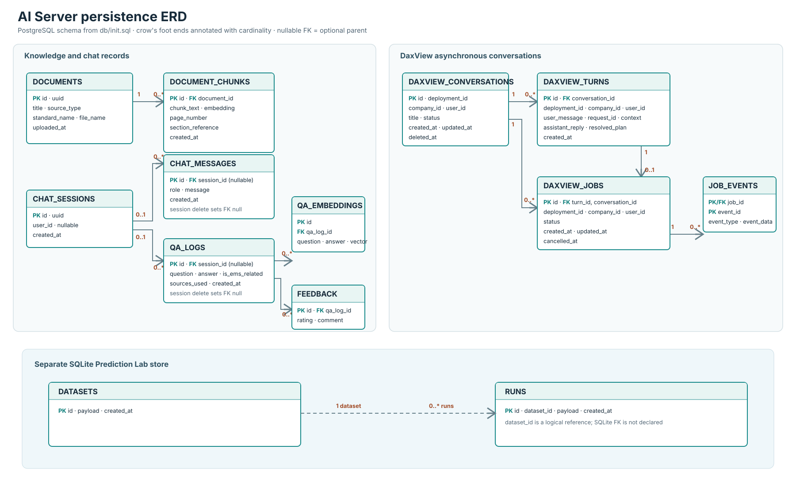
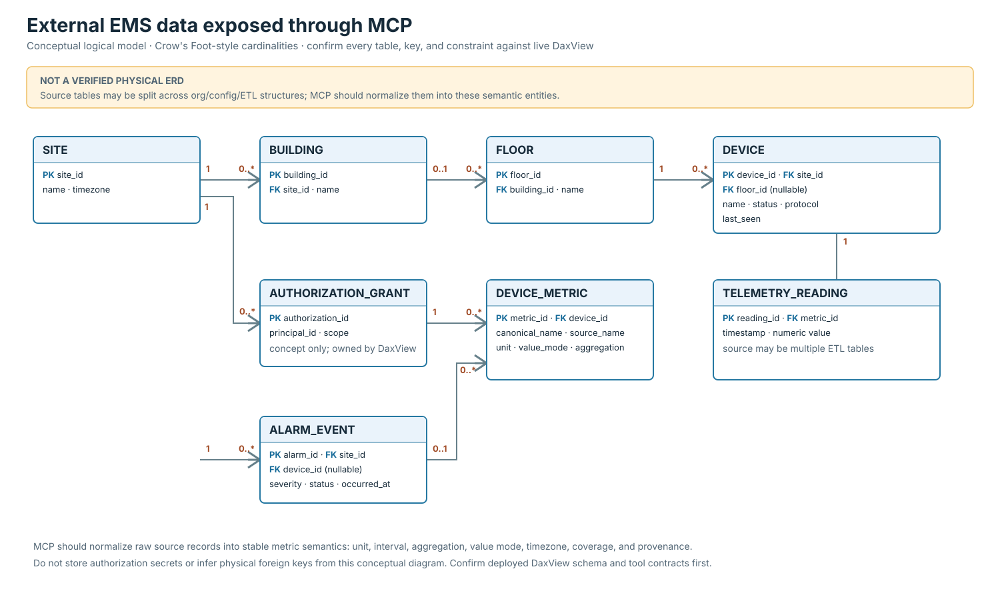
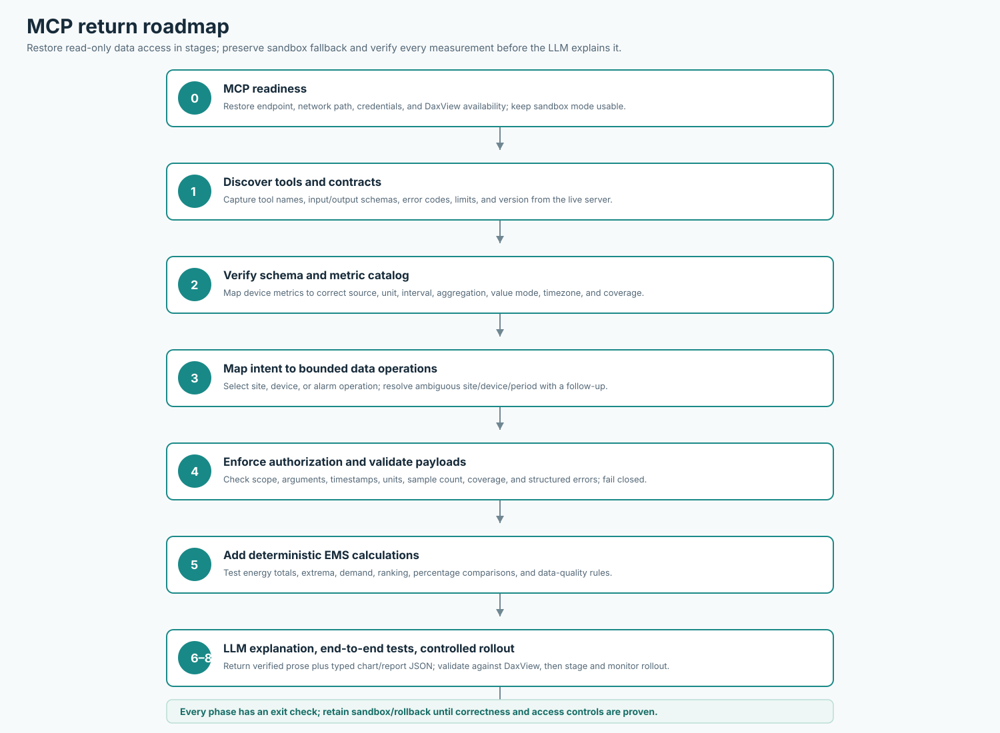
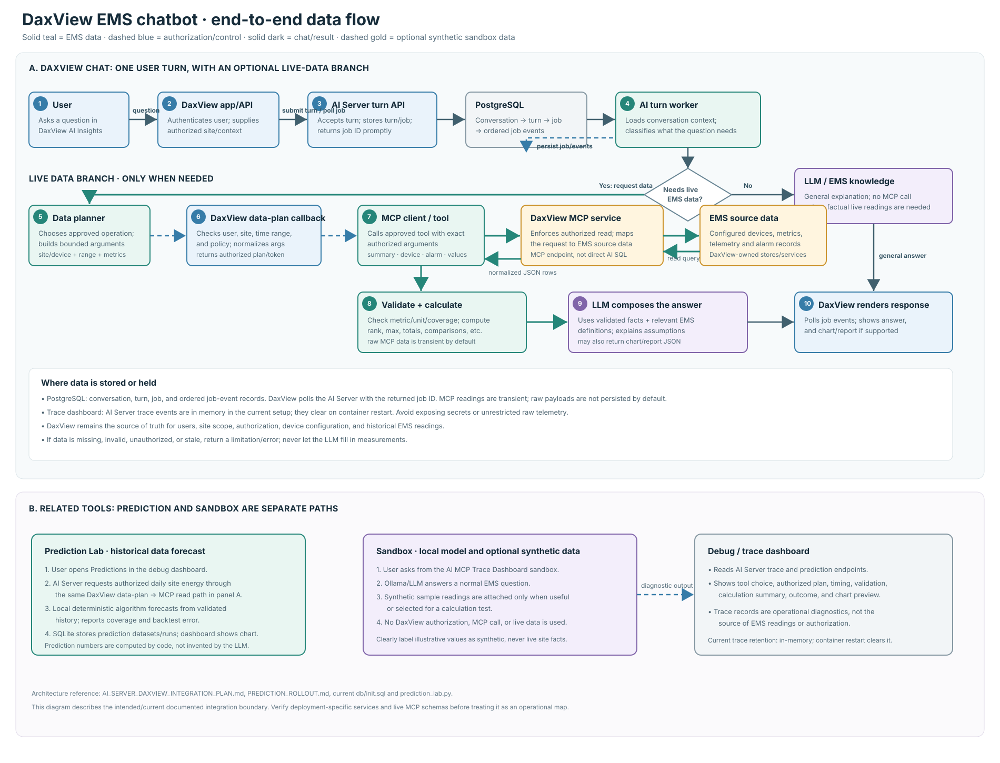
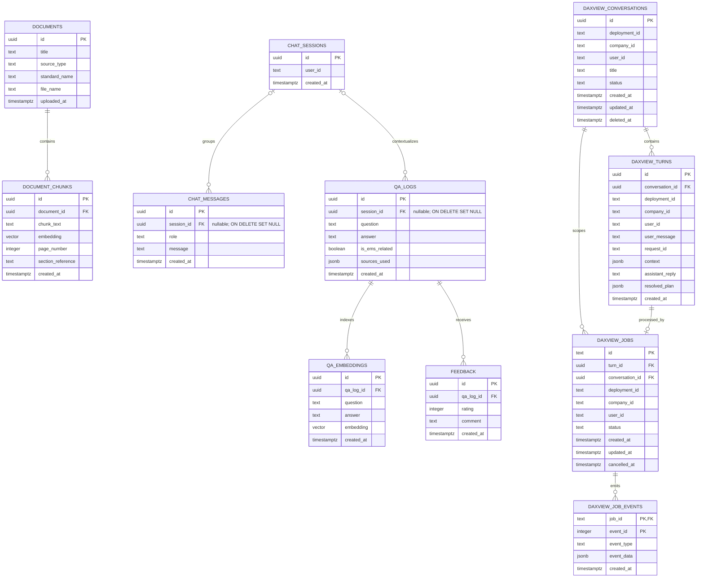
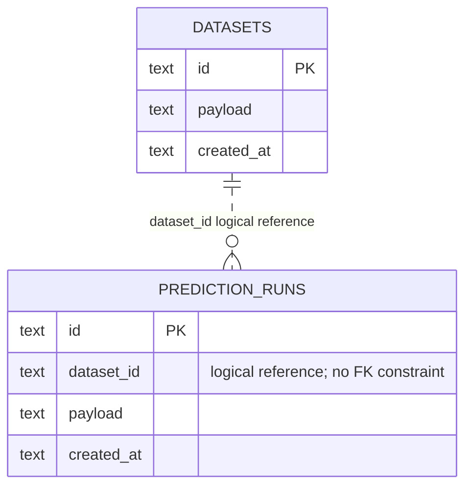
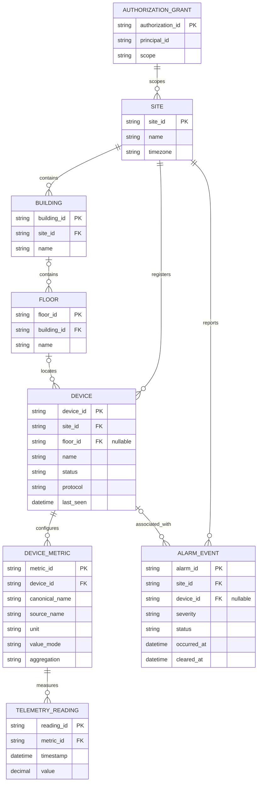
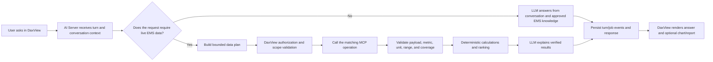
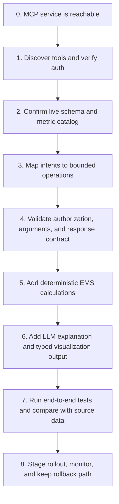

# EMS MCP ERD and Implementation Roadmap

This document captures the current AI Server persistence model, a conceptual model of the external DaxView EMS data exposed through MCP, and a staged plan for reconnecting MCP. It is based on the checked-in SQL and Python code plus the MCP integration proposals. It is not a claim that the external DaxView database has these exact tables or constraints.

## Image Diagrams

The following SVGs are vector images and can be zoomed or printed without losing clarity.

### AI Server and Prediction Store ERD

### Conceptual External EMS ERD

### MCP Return Roadmap

### Whole-System Data Flow

## 1. Current AI Server ERD

The PostgreSQL tables below are defined in `AI-Server/db/init.sql`. Crow's Foot endpoints show the relationship cardinality. Nullable FKs are optional; `ON DELETE` behavior is noted where relevant.

**Relationship notes**

- A document can have zero or many chunks; every chunk belongs to one document and is deleted with it.
- A chat message or QA log may have no session (`session_id` is nullable); deleting a session clears that reference rather than deleting the record.
- A QA log can have multiple embeddings and feedback records; deleting the QA log cascades to both.
- A DaxView conversation contains turns and jobs. Each turn and job belongs to one conversation.
- A job belongs to one turn. The unique index on `(deployment_id, conversation_id, turn_id)` limits a turn to one job within that deployment/conversation scope.
- A job has zero or many ordered events; `(job_id, event_id)` is the event primary key.

## 2. Prediction Lab ERD

Prediction Lab uses SQLite, separate from the PostgreSQL database above. `datasets` and `runs` are defined in `AI-Server/prediction_lab.py`. The `dataset_id` link is application-level today; SQLite does not declare a foreign-key constraint for it.

Datasets hold imported or synthetic time-series input. Runs hold forecast configuration, calculated output, and run metadata in their JSON payload. The diagram intentionally distinguishes this local test store from live MCP telemetry.

## 3. Conceptual External EMS Data Model

This is a **logical integration model**, not a verified physical DaxView ERD. It describes the entities the MCP/API should expose in a normalized contract. Names in the existing handoff (such as `org_device`, `org_building`, `org_floor`, `config_modbus_parameter`, and ETL tables) are reference names from the supplied integration documentation; verify them against the live DaxView schema and MCP tool definitions before implementation.

**Important modeling boundaries**

- `AUTHORIZATION_GRANT` is a conceptual representation of the authorization context, not a recommendation to store authorization secrets in the AI Server database. DaxView remains the authority for identity and access; MCP requests must use the authorized scope.
- Telemetry may be stored across multiple ETL/source tables rather than one `TELEMETRY_READING` table. The MCP response should normalize source names, metric meaning, units, timestamps, aggregation, and data coverage.
- Energy registers, interval energy, active power, and demand are not interchangeable. The MCP contract should expose the measurement semantics (`value_mode`, unit, aggregation, interval) so calculations use the right input.
- Confirm whether alarms, locations, and sites have the shown identifiers and FK cardinality. The supplied reference does not prove those physical constraints.
- Live MCP results are transient evidence in the current flow; this ERD does not imply telemetry is copied into the AI Server database.

## 4. Runtime Data Flow After MCP Returns

The LLM can interpret the request and explain results; it must not invent measurements or perform unverified arithmetic. Deterministic code should calculate extrema, ranking, percentage differences, demand, and forecast values from validated numeric inputs. If data is missing or invalid, return a clear unavailable/insufficient-data result rather than a plausible-looking answer.

## 5. MCP Return Roadmap

| Phase | Work | Exit check |
|---|---|---|
| 0. Readiness | Confirm MCP endpoint, network, credentials, and DaxView availability. Keep sandbox mode available while this is being restored. | Health check succeeds from the deployed AI Server; credentials remain server-side. |
| 1. Tool discovery | Call MCP tool discovery and capture tool names, input schemas, output schemas, and error codes. | Versioned tool contract is recorded; no assumptions from old logs. |
| 2. Schema and metrics | Verify site/device identifiers, configured metrics, source columns, units, value mode, interval, timezone, and retention. | Metric catalog maps each user concept (energy, demand, voltage, current) to valid source metrics and semantics. |
| 3. Intent/data-plan mapping | Map user requests to `site_summary`, `device_data`, or `alarm_data`; request clarification for ambiguous site/device/period. | Test cases show the expected operation and arguments, including multi-part questions. |
| 4. Authorization and payload checks | Preserve the existing authorization callback. Validate scope, bounds, timestamps, units, sample count, coverage, and structured MCP error responses. | Out-of-scope requests and malformed/empty data fail closed with useful messages. |
| 5. Deterministic analytics | Implement and unit-test calculations for energy totals, peak/max demand, extrema, rankings, percentage differences, and data-quality checks. | Expected answers match hand-calculated fixtures; cumulative registers are differenced and interval rules are explicit. |
| 6. LLM and visual output | Give the LLM only the question, conversation context, verified results, and relevant EMS definitions. Return structured chart/report JSON alongside prose. | The prose and chart use the same validated rows; charts identify metric, unit, period, and source. |
| 7. End-to-end verification | Test DaxView -> AI Server -> authorization -> MCP -> calculations -> LLM -> DaxView rendering. Include missing data, invalid metric, timeout, and multi-question cases. | Trace shows selected tool, arguments, validation outcome, model, calculation inputs, and final response. |
| 8. Controlled rollout | Enable for a small test scope, compare a sample of outputs with DaxView/source readings, monitor errors and latency, then widen. Keep a feature flag or rollback to sandbox/read-only mode. | No unresolved critical correctness/security issues; rollback is exercised. |

### First MCP smoke-test set

1. List authorized sites and devices; confirm IDs and names match DaxView.
2. List available metrics for one known device; verify voltage, current, active power, and energy are distinguished by unit and source metric.
3. Request one short time range for a known metric; compare timestamp, unit, and value against DaxView.
4. Request site energy summary for a bounded period; independently recompute total and daily high/low from returned rows.
5. Request alarms for a bounded period; verify severity counts and latest occurrence against the source.
6. Test missing metric, empty range, unauthorized site, timeout, and malformed payload; confirm safe error messages and no fabricated answer.

## 6. Verify Before Treating This as a Physical ERD

Before handing this to a database or MCP implementer, verify the deployed DaxView schema, actual FK constraints, metric-source mappings, alarm storage, and authorization mechanism. Update the conceptual diagram to match the verified schema, while keeping the AI Server PostgreSQL and SQLite diagrams tied to their migrations/code. Do not add local telemetry persistence simply to make the diagram look relational; first decide retention, privacy, authorization, and source-of-truth requirements.
